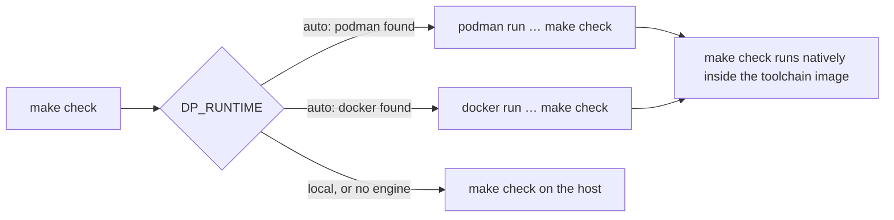

# Container-first development

Every task in every Dialectic Playground repository (building, testing, linting, formatting,
rendering documentation and brand assets) runs inside a **toolchain container** by default.
The container reads and writes your working tree directly; it is a clean, pinned environment,
not a separate copy of the code. This page explains why, how it works, and where it
deliberately stops.

## Why containers first

**One toolchain definition.** Each repository's `Containerfile` names its toolchain: an
official image (for example `astral-sh/uv` with Python, or a language's official image),
pinned by digest. `make`, the editor's dev container, and CI all use that same image. "Works on
my machine" stops being a question of which compiler or library version happens to be
installed.

**Nothing to install but a container engine.** A contributor needs Podman (or Docker), `make`,
and `git`. Rust, Go, Python, Inkscape, and fonts arrive with the image, at the versions the
repository chose.

**Reproducible outputs.** When the toolchain is pinned, outputs can be too. The brand assets
are the clearest example: the asset image pins Inkscape (from a dated Debian snapshot) and the
brand fonts (checksum-verified). CI regenerates every image and fails if a single byte differs
from what is committed.

**Missing dependencies surface immediately.** A clean image contains only what the
`Containerfile` declares, so a script that silently relied on a tool installed on someone's
laptop fails at once, not months later on someone else's machine.

## How it works

Every repository has the same two shared files, byte-identical across the organization. The
canonical copies live in the [`.github`](https://github.com/dialectic-playground/.github)
repository, and each repository's CI fails if its copies drift:

- **`tools/dp-run`** runs a command in the toolchain environment. It mounts the repository at
  the same path inside the container, keeps your working directory, and creates files with
  your user and group IDs, so nothing ends up owned by root.
- **`tools/container.mk`** is included at the top of each repository's `Makefile`. When you run
  `make check`, it re-runs `make check` *inside* the container. Inside, the variable
  `DP_IN_CONTAINER=1` tells the same Makefile to run the goal natively, so containers never
  nest.

### Choosing where tasks run

The runtime is chosen in a fixed order: **Podman**, then **Docker**, then the **local
system**. The one-line banner on standard error always says which one was used. Override the
choice with environment or `make` variables:

| You want to… | Use |
| :-- | :-- |
| Use the default order | nothing (`DP_RUNTIME=auto`) |
| Force an engine | `DP_RUNTIME=podman` or `DP_RUNTIME=docker` |
| Use your own installed toolchain | `DP_RUNTIME=local` |
| Try a different image | `DP_IMAGE=<image reference>` |

The [container tooling reference](../reference/container-tooling.md) lists every variable,
target, and convention.

## Containers and the cross-platform promise

Containers are **Linux**. The curriculum, however, promises identical behavior on Linux,
macOS, and Windows, and native macOS or Windows behavior cannot be observed inside a Linux
container. The two goals are reconciled like this:

- **Day-to-day work** uses the container by default, everywhere, for a consistent toolchain.
  On macOS and Windows, Podman and Docker run the Linux image in a lightweight virtual machine.
- **Native verification** uses `DP_RUNTIME=local`. That is how you check behavior on your own
  operating system, and it is the only mode in which a macOS or Windows build is produced.
- **CI does both.** Every repository runs its `make` targets in a Podman container on Linux
  *and* natively. Curriculum and language repositories run natively on Linux, macOS, and
  Windows. A change is accepted only when all of them pass.

## Trade-offs

- **First run is slower.** The image is built (or pulled) once and cached; later runs start in
  about a second.
- **Linux on macOS and Windows.** File access through the container engine's virtual machine
  is slower than native access, and the binaries you build are Linux binaries. Use
  `DP_RUNTIME=local` when you need native ones.
- **Two toolchains to keep green.** Because CI runs both container and native jobs, a change
  that works in one but not the other is caught, at the cost of maintaining the native setup
  too.

## Further reading

- [Container tooling reference](../reference/container-tooling.md)
- [Cross-platform determinism](cross-platform-determinism.md)
- [Organization settings](../reference/organization.md)
